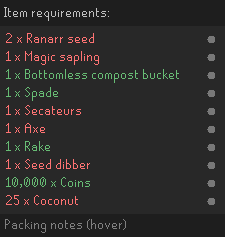

# Farm Run Planner

Build your own farming runs in RuneLite. Pick the patches you use, save them under a name, and follow the route from the sidebar.

By **Astral** · [Source](https://github.com/dovermlg/farm-run-planner) · [Issues](https://github.com/dovermlg/farm-run-planner/issues) · [Build checks](https://github.com/dovermlg/farm-run-planner/actions/workflows/check.yml)

## Features

- Choose from 99 recurring farming patches across 21 crop types.
- Create named presets in RuneLite's normal plugin settings cog.
- Import and export saved presets as local JSON files.
- Save a chosen crop tier for each patch type, with no lower-tier substitutions.
- Load one saved farming setup for the sidebar and bank, with equipment on the left and inventory on the right.
- Split supplies into inventories, with a saved bank choice and packing list for each load.
- Start a saved run from the sidebar, with travel instructions and a patch checklist.
- Highlight the next step's teleport item in your inventory or worn equipment.
- Include route teleports in required items, using tablets by default or chosen spell runes.
- Capture your backpack and worn gear in a dedicated setup editor on the main tab, with a physical Save setup button.
- Check captured slots and current farming requirements, with shortages in red.
- Reorder selected patches using your travel preferences and estimated travel costs.
- Track observed crops, estimated ready times and full-run reminders.
- Keep preset libraries, checklist progress and crop observations in local files.

The starting selection is the classic 16-patch tree run: six normal trees, six fruit trees, three Fossil Island hardwoods and the Tai Bwo Wannai calquat. Herbs, Trees and Herbs + trees are also included as starter presets. Adjust them for your account's unlocks.



## Create a preset

1. Enable **Farm Run Planner** and open its settings cog in RuneLite's Configuration tab.
2. Under **Your run → Preset to edit**, choose an **Empty** slot.
3. Leave and reopen the settings page to refresh its fields.
4. Enter a **Preset name**, select patches, and choose crops under **Crops and supplies**, and set your travel and display preferences.
5. Click **Save preset** and confirm.
6. Open the spade-and-sprout sidebar tab and select the saved name under **Choose your run**.

Save and Delete use RuneLite's checkbox controls. Toggling either one performs the action after confirmation; the tick does not enable automatic saving. The plugin must be enabled for these actions to work.

### Edit, copy or delete

To edit a preset, select its slot, leave and reopen the cog, then make your changes and save. Changing the name in an occupied slot renames that preset. To make a copy, choose an empty slot; it starts with your current settings. Give it a new name and save.

Switching slots replaces the working draft, so save any changes you want to keep first. **Delete named preset** removes the selected saved slot and keeps the current working run. Names must be unique and between 1 and 60 characters.

There are 32 editable slots, including the starter presets. Older libraries with more names remain available in the sidebar; freeing a slot and restarting assigns another older preset to it. Deleted starter presets stay deleted.

## Import and export presets

Open **Preset backups** in the normal settings cog. These controls work like Save preset: toggle the checkbox and confirm. The result appears in the run tab.

To make a backup:

1. Save any draft changes you want to include. Exports contain all **saved** presets.
2. Set **Backup filename**, or leave it as `presets.json`.
3. Click **Export presets** and confirm. An existing file with that name is replaced.

Files are stored in:

```text
<RuneLite data folder>/plugin-data/farm-run-planner/preset-backups/
```

On Windows, this is normally `%USERPROFILE%\.runelite\plugin-data\farm-run-planner\preset-backups\`. Copy the JSON file to back it up or share it. This folder is shared by the plugin's configuration profiles; use different filenames to keep separate backups.

To restore or import a shared file, copy it into that folder, enter its filename in the cog, and click **Import presets**. Reopen the cog after importing to refresh its preset list. The [example backup](docs/preset-backup-example.json) contains two sample runs you can try without entering a game world.

Imports keep the current draft, checklist and existing presets. An identical preset with the same name is skipped. If the name exists with different settings, the imported copy receives a name such as `Herbs (imported)`. The entire file is validated before saving; invalid files or insufficient free editor slots cancel the whole import. Files must be valid Farm Run Planner JSON, no larger than 1 MB, with at most 256 entries. New presets must fit within the 32 editor slots.

Backups contain preset names, selected patches in route order, crop choices, supply options, saved equipment, bank-display choice, inventory planning and travel/display preferences. Version 7 exports include an optional captured backpack with its positions, quantities and noted forms. Formats 1-6 remain importable without a captured backpack; formats 1-5 use the default bank layout; formats 1-4 have no saved equipment, and formats 1-3 use tablet supplies by default. Formats 1 and 2 retain the historical Grand Exchange bank default and other inventory defaults; format 1 also uses default crop choices. Review the defaults before starting an older preset. Character identifiers, crop observations, reminder records, patch and bank completion marks, and tracking controls are excluded. Files stay local unless you choose to copy or share them.

## Capture a backpack and gear setup

1. Create and save the farming preset in the normal cog, then select its name in the main plugin tab.
2. Click **Inventory setup**. This opens a separate editor inside the same sidebar.
3. Arrange your backpack and wear your farming gear, then click **Capture backpack and gear**.
4. Choose the bank display: **Equipment and inventory layout**, **Filter only**, or **Off**.
5. Click **Save setup**, then **Back to run**.

Capture changes the preview only. Save setup stores it with that named farming preset. Leaving a changed preview offers **Discard changes and back**; live inventory changes never autosave. Saving a setup keeps the route, patch completion marks and generated bank-stop acknowledgments. Crop tiers, travel, route selection and farming-preset management stay in the cog.

The saved backpack preserves all 28 positions, gaps, quantities and noted forms. Grid checks each slot against the saved item and at least its saved quantity; an unexpected item in a saved empty slot is also flagged. Gear checks its intended worn slot. Red means a mismatch or shortage, green means a match, and gray means unknown. Saved equipment and the backpack drive the bank display together. RuneLite's built-in Bank Tags provides that view; Inventory Setups is not required.

The captured setup stays fixed during the run. Calculated **Item requirements** remain visible underneath and follow the current inventory, including required teleports. Saving a capture does not automatically add supplies you forgot to pack. Compare the requirements before capturing. For a run split into multiple inventories, the same captured setup is shown at each bank stop; the calculated list still advances by load.

Without a captured backpack, existing presets keep their calculated supply grid. **Use calculated run supplies** in the editor clears the captured backpack and gear from the preview; click Save setup to keep that change. Click the **eye beside Packing checklist** to reveal the backpack, equipment, requirements and **Grid/List** selector. This section starts collapsed and keeps your visibility choice during progress updates. See [setup editor](docs/setup-editor.md), [visual packing](docs/packing-view.md) and [bank display](docs/setup-banking.md).

## Pack for a run

1. In the cog, open **Crops and supplies** and choose one crop for each patch type you use. Choose **Harvest / check only** for patches you will not replant.
2. Open **Inventory planning**. Choose **Bank between inventories**, set **Reserved inventory slots** for travel gear and harvested crops, and decide whether to **Pack protection as notes**. Click **Save preset** to keep these choices.
3. Select that preset in the sidebar. Its saved setup links to the bank automatically. **Start run** starts fresh and asks before clearing existing completion marks.
4. Open a bank. The default display puts saved equipment on the left and your captured backpack on the right. Presets without a capture use the current load's calculated supplies instead. Missing layout items may appear as Bank Tags placeholders; they are not owned supplies. Withdraw and equip items yourself.
5. Click the **eye beside Packing checklist** to show **Item requirements**. Compact lines such as `6 x Magic sapling` show the required quantity with an item icon on the right. Red means short; green means enough carried supplies. Hover a line or icon for the carried count and exact shortage. Click the eye again when ready to follow your route.

The sidebar shows **Inventory N of M** and inserts stops at your chosen bank between loads. When you finish a load's patches, its calculated checklist switches to the next inventory. A captured bank setup stays fixed; a calculated bank setup follows the next inventory. At the bank, deposit harvested produce and withdraw the listed supplies. **Show setup in bank** reopens the view without resetting progress. Click **Banked - continue** on the bank card when ready; this keeps your patch progress. The same bank is used for every resupply stop in that preset. **Custom bank** lets you enter directions for another bank.

The planner uses RuneLite's item definitions to count stacks and individual items. It starts with eight reserved slots, counts tools as backpack space even when worn, and does not predict harvested quantities or stored supplies. Increase the reserve for a large harvest, or note produce at a leprechaun yourself. A single patch that exceeds capacity stays in the route with a warning. Disable **Plan inventory loads** for the full remaining-run list. See [inventory planning](docs/inventory-planning.md) for the calculation and bank travel options.

Hover **Packing notes** for tool, protection and travel reminders. A gray line means the carried quantity is unknown. Icons identify the item; they do not indicate bank availability.

Counts include your inventory and worn equipment, not your bank, leprechaun storage, seed-box contents or bottomless bucket charges. Planting supplies must be unnoted. With **Pack protection as notes** enabled, noteable protection rows require notes so the supplies use the planned space. Disable that option to plan loose payments. Mark each finished patch complete to remove its planting supplies from the current inventory's remaining quantities. Counts are unknown while logged out.

For a bottomless bucket, select **Crops and supplies → Compost → Bottomless compost bucket**, then **Save preset**. This replaces regular application buckets with one filled bottomless bucket. The filter also shows an empty bucket for refilling. The checklist confirms possession only; check the stored compost type and charges yourself. Gardener payments still require their usual items.

Protection payments are included by default wherever a gardener is listed. They are optional, and you can start without them. Payments use the exact required form, including filled baskets or sacks. Disable **Include protection payments** if you do not want to pack them. Protected trees omit compost except celastrus, which can use it to improve yield. A **Coin budget** of 10,000 is a starting allowance, not a calculated fare or removal total. Adjust it for your route.

**Close setup bank view** pauses the bank display until you select a saved preset, start a run or click **Show setup in bank**. Closing the bank or logging out keeps the selected setup ready for the next visit. Progress updates refresh an active farming view without switching away from another bank tag you selected. Opening the farming view clears the current search through RuneLite's normal Bank Tags API; saved tags are preserved. Editing the draft pauses or clears the old view.

You choose which axe you can use, travel equipment, combat gear, diving equipment and belladonna gloves. The checklist includes common axes and shows reminders for special equipment. Turn off the rake, dibber or other tool recommendations if your unlocks or stored tools replace them. Read the [supply reference and limits](docs/supplies.md) for details.

## Follow a run

Selecting a saved run in the sidebar starts a fresh checklist. Loading its slot for editing keeps the current completion marks. Check **Completed** after each patch, or uncheck it to correct a mark. After **Start run**, the next unfinished patch or pending bank stop has a green border. Resetting or switching presets clears this highlight until Start run is clicked again. The progress bar turns green when the run is complete.

The same button changes to **Stop run** while active. Stopping hides on-screen directions, step borders and teleport outlines, closes the linked bank setup, and keeps patch and bank completion marks. Stop remains available while route or item planning refreshes. The button returns to Start run after stopping or completing the last patch. Starting again begins a fresh run and asks before clearing existing marks; use Reset run to clear them separately.

**Reset run** clears patch and bank completion marks, including marks for patches currently excluded from the route. It keeps your presets and settings. Progress is saved between sessions; there is no daily or logout reset. Undoing a patch restores any bank stops after that inventory.

Removing or adding a patch recalculates the route when **Optimize route** is enabled. With optimization off, the stored order is kept. Travel settings include a **Catherby charter ship** option for Brimhaven: walk from Catherby fruit patch to the docks, charter to Brimhaven, then walk to its fruit patch. Bring coins for the fare.

Every selection from the current catalogue has an exact minimum order for the plugin's estimated travel scores, including all 99 patches. The [route-combination audit and proof](docs/route-optimality.md) cover all current travel settings. Actual journey times and a combined search over patch order and banking are outside that guarantee.

Bring your seeds or saplings, tools, compost or protection payments, and travel supplies. The checklist tracks each patch as one stop; it does not separately track harvesting, clearing, planting and protection.

### Teleport supplies

Under **Travel**, leave **Include teleport supplies** enabled and choose **Teleport supplies**. Tablets are the default; spell runes are optional. Save the choice with each preset. Required quantities follow actual walking links and bank trips, and completed patches drop out. POH, fairy-ring, spirit-tree, diary, charge and unlock requirements still need manual checks. See [teleport supplies](docs/teleport-supplies.md).

### Next teleport highlight

**Checklist display → Highlight next teleport** is on by default. During a started run, the matching carried item gets a green outline in your inventory or worn equipment, and the sidebar names it beside the next step. The highlight follows your selected travel preferences and advances when you mark a patch complete, including optional observed replant completion. Stopping, resetting or finishing the run clears it.

At a resupply stop it switches to the chosen bank's device. Click **Banked - continue** to advance to the next patch's travel. Walking links and local bank walks have no item outline. A Catherby charter leg from Catherby also needs no further teleport.

The highlight is guidance only. Use the written route directions for the destination. For instructions that allow a spell or tablet, the tablet can be outlined when carried and tablet supplies are selected; spell-rune mode suppresses that tablet outline. Spells, runes, POH objects, fairy rings and spirit trees are not highlighted. Empty jewellery and noted copies are excluded. Check diary limits, charges stored outside the item ID and travel unlocks yourself. Custom bank text is not interpreted as an item choice. Nothing is clicked, equipped or teleported automatically.

This is a global display preference; loading or importing a preset does not change it. Read the [supported devices and limits](docs/teleport-highlights.md) for details.

### Current step on screen

**Checklist display → Show current step on screen** is on by default. Click **Start run** to show a movable, resizable panel in the top left of the game view with the current stop, travel directions, crop readiness and completion count. It follows sidebar completion and bank acknowledgments even with the sidebar closed, and shows bank instructions before the next inventory. The overlay disappears when the last patch is complete. Resetting, switching presets or reopening the plugin keeps it hidden until Start run is clicked again; the sidebar keeps the completed checklist and green progress bar. Complete patches and bank stops in the sidebar.

Hold **Alt** and drag the overlay to move it using RuneLite's normal overlay controls. Turn off the cog setting to hide it. The overlay is hidden while logged out, while editing an inventory setup, and when no patches are selected. It displays a preparation message while route or inventory planning is pending. This display preference applies across presets. [Details and offline preview](docs/run-step-overlay.md).

## Crop tracking and reminders

These options are under **Your run** in the settings cog:

| Setting | Behavior |
| --- | --- |
| Track crop readiness | Shows estimated ready times and skips healthy, still-growing hardwoods when preparing a run. On by default. |
| Notify when run is ready | Sends a RuneLite notification when every patch in a saved preset is estimated ready. On by default. |
| Auto-mark replanted patches | Checks a stop after a stable replanting transition is observed during that visit. Off by default. |

These tracking settings apply across presets. Visit patches with tracking enabled to record their crop states. Unknown, empty, diseased, dead or stump states block a full-run reminder. A mixed herb-and-tree preset waits for the trees as well as the herbs. Reminders cover all saved presets, and RuneLite's notification settings control their sound and display.

Growing hardwoods stay saved in your preset but are temporarily left out of the route, calculated item requirements, inventory loads and bank stops. The sidebar lists the skipped trees and their estimated ready times. Unknown, empty, unhealthy, mature and stump patches stay included. Before starting, timers can bring trees back into the plan automatically. **Start run** or the first completion fixes that run's included patches; **Reset run**, starting a fresh run or loading a preset checks readiness again. Other crop types keep their existing behavior. [Hardwood planning details](docs/hardwood-readiness.md).

RuneLite must be running with the plugin enabled to send reminders. After restarting, log into the character to load its observations. The running client can continue reminders after logout. First seeing an already mature crop does not trigger an alert; a growing or regrowing crop must have armed that preset's cycle first.

**Ready times are estimates based on the last observed growth stage.** The tracker does not know your exact farming-tick offset or detect disease while you are away. Revisit patches to update their health and growth. Fruit trees, bushes and cacti estimate full regrowth; anima shows an estimated replacement time. Resetting the checklist does not restart crop timers. Auto-completion requires an observed replant, rather than arrival or a health check.

## Patch coverage

| Crop type | Patches | Crop type | Patches |
| --- | ---: | --- | ---: |
| Normal tree | 7 | Fruit tree | 7 |
| Hardwood | 5 | Calquat | 3 |
| Allotment | 17 | Flower | 9 |
| Herb | 10 | Hops | 5 |
| Bush | 5 | Cactus | 2 |
| Seaweed | 2 | Grape | 12 |
| Spirit tree | 5 | Belladonna | 2 |
| Coral nursery | 2 | Mushroom | 1 |
| Crystal tree | 1 | Celastrus | 1 |
| Redwood | 1 | Hespori | 1 |
| Anima | 1 | **Total** | **99** |

The catalogue includes regular plantable patches, including newer Varlamore and Sailing locations. Quest-only plots, activity plots, compost bins and POH construction spaces are excluded. Spirit trees are opt-in; the Trees starter preset excludes them. The included starter presets select 10 herb patches, 25 tree-related patches, or their 35-patch union.

Check the [patch catalogue](docs/PATCH-CATALOGUE.md) for locations and access notes. Unlocks are not detected automatically. Seed-specific levels, equipment restrictions and Hespori combat preparation still apply.

## How routes are ordered

Routes use relative travel-effort scores, rather than measured seconds or live pathfinding. Runs with up to 16 patches use an exact solver for those scores. Runs with 17–99 patches use a bounded search that keeps the existing order if it cannot improve the score. Nearby patches are grouped where the travel model supports a walking connection.

This gives a suggested route. It does not check your current position, bank, spellbook, teleport charges or unlocks, and it does not plan banking. Choose travel methods you can use. See [the travel verification notes](docs/VERIFICATION.md) for sources and limitations.

## Privacy and backups

The plugin has no database, hosting service, signup, analytics or developer backend. It makes no network requests and sends no farming data to the author.

Saved presets, slot names, checklist marks, crop observations and reminder records use a local file for each RuneLite configuration profile:

```text
<RuneLite data folder>/plugin-data/farm-run-planner/profile-<profile ID>.properties
```

On Windows, the folder is normally `%USERPROFILE%\.runelite\plugin-data\farm-run-planner\`. Copy it with RuneLite closed to back up your data. Avoid editing the same profile from simultaneous clients, since the last writer wins. Use separate RuneLite profiles for separate preset libraries. Crop observations are also separated by character and world mode using a local one-way key; the raw account hash is not saved.

**Active cog settings follow RuneLite's normal optional configuration sync.** Loading a preset copies its settings into that active configuration. The separate preset library and crop records remain local. Keep RuneLite profile sync off if you want the active settings to stay local too. The plugin does not change your sync preferences.

Existing presets are migrated automatically. RuneLite moves the old `farm-run-planner` data directory when the new destination does not exist. If both directories already exist, back up both before resolving them with the client closed.

## Build and run locally

Install **JDK 11**, set `JAVA_HOME`, and open a terminal in the project folder:

```powershell
.\gradlew.bat test build
.\gradlew.bat run
```

On macOS or Linux, use `./gradlew test build` and `./gradlew run`. The wrapper downloads Gradle 8.10 and verifies its checksum. The first build also downloads RuneLite dependencies.

`test build` runs without launching the game or using an account. `run` launches a RuneLite development client with the plugin loaded. Enable Farm Run Planner to open its sidebar. The JAR in `build/libs/` is a plugin, not a standalone application or a file to copy into an installed client's directory.

IntelliJ can import `build.gradle` with JDK 11 as the Gradle JVM. Run the Gradle `run` task or `ClassicTreeRunLauncher.main()` with `--developer-mode --debug`. Jagex account setup is covered by [RuneLite's development guide](https://github.com/runelite/runelite/wiki/Using-Jagex-Accounts).

## Tests and reference data

The default RuneLite dependency is `latest.release`. To reproduce the audited version:

```powershell
.\gradlew.bat '-PruneliteVersion=1.13.2' test build
.\gradlew.bat -I tools/reference-export.gradle '-PruneliteVersion=1.13.2' verifyFarmingReference
```

Test results are in `build/reports/tests/test/index.html`. The reference check compares the bundled farming tables and patch boundaries against the RuneLite dependency. Tests use offline fixtures and do not log into RuneScape. Live crop timing and desktop notification delivery have not been validated.

- [Build results](docs/BUILD-REPORT.md)
- [Optimization and reliability review](docs/REVIEW.md)
- [Farming data audit and sources](docs/DATA-AUDIT.md)
- [Plugin Hub review notes](docs/HUB-REVIEW.md)
- [GitHub and submission setup](docs/GITHUB.md)
- [Third-party notices](THIRD-PARTY-NOTICES.md)

The plugin displays guidance, filters the bank display and tracks progress. Withdrawing, equipping, walking, teleporting, harvesting and planting are performed by the player. Local development changes must be released through a Plugin Hub update before installed users receive them.
