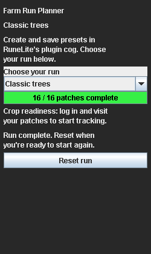

# Farm Run Planner

Build your own farming runs in RuneLite. Pick the patches you use, save them under a name, and follow the route from the sidebar.

By **Astral** · [Source](https://github.com/dovermlg/farm-run-planner) · [Issues](https://github.com/dovermlg/farm-run-planner/issues) · [Build checks](https://github.com/dovermlg/farm-run-planner/actions/workflows/check.yml)

## Features

- Choose from 99 recurring farming patches across 21 crop types.
- Create named presets in RuneLite's normal plugin settings cog.
- Start a saved run from the sidebar, with travel instructions and a patch checklist.
- Reorder selected patches using your travel preferences and estimated travel costs.
- Track observed crops, estimated ready times and full-run reminders.
- Keep preset libraries, checklist progress and crop observations in local files.

The starting selection is the classic 16-patch tree run: six normal trees, six fruit trees, three Fossil Island hardwoods and the Tai Bwo Wannai calquat. Herbs, Trees and Herbs + trees are also included as starter presets. Adjust them for your account's unlocks.



## Create a preset

1. Enable **Farm Run Planner** and open its settings cog in RuneLite's Configuration tab.
2. Under **Your run → Preset to edit**, choose an **Empty** slot.
3. Leave and reopen the settings page to refresh its fields.
4. Enter a **Preset name**, select patches, and choose your travel and display settings.
5. Click **Save preset** and confirm.
6. Open the green tree sidebar tab and select the saved name under **Choose your run**.

Save and Delete use RuneLite's checkbox controls. Toggling either one performs the action after confirmation; the tick does not enable automatic saving. The plugin must be enabled for these actions to work.

### Edit, copy or delete

To edit a preset, select its slot, leave and reopen the cog, then make your changes and save. Changing the name in an occupied slot renames that preset. To make a copy, choose an empty slot; it starts with your current settings. Give it a new name and save.

Switching slots replaces the working draft, so save any changes you want to keep first. **Delete named preset** removes the selected saved slot and keeps the current working run. Names must be unique and between 1 and 60 characters.

There are 32 editable slots, including the starter presets. Older libraries with more names remain available in the sidebar; freeing a slot and restarting assigns another older preset to it. Deleted starter presets stay deleted.

## Follow a run

Selecting a saved run in the sidebar starts a fresh checklist. Loading its slot for editing keeps the current completion marks. Check **Completed** after each patch, or uncheck it to correct a mark. The next unfinished patch has a green border, and the progress bar turns green when the run is complete.

**Reset run** clears all completion marks, including marks for patches currently excluded from the route. It keeps your presets and settings. Progress is saved between sessions; there is no daily or logout reset.

Removing or adding a patch recalculates the route when **Optimize route** is enabled. With optimization off, the stored order is kept. Travel settings include a **Catherby charter ship** option for Brimhaven: walk from Catherby fruit patch to the docks, charter to Brimhaven, then walk to its fruit patch. Bring coins for the fare.

Bring your seeds or saplings, tools, compost or protection payments, and travel supplies. The checklist tracks each patch as one stop; it does not separately track harvesting, clearing, planting and protection.

## Crop tracking and reminders

These options are under **Your run** in the settings cog:

| Setting | Behavior |
| --- | --- |
| Track crop readiness | Shows the observed crop and its estimated ready time on each patch card. On by default. |
| Notify when run is ready | Sends a RuneLite notification when every patch in a saved preset is estimated ready. On by default. |
| Auto-mark replanted patches | Checks a stop after a stable replanting transition is observed during that visit. Off by default. |

These tracking settings apply across presets. Visit patches with tracking enabled to record their crop states. Unknown, empty, diseased, dead or stump states block a full-run reminder. A mixed herb-and-tree preset waits for the trees as well as the herbs. Reminders cover all saved presets, and RuneLite's notification settings control their sound and display.

RuneLite must be running with the plugin enabled to send reminders. After restarting, log into the character to load its observations. The running client can continue reminders after logout. First seeing an already mature crop does not trigger an alert; a growing or regrowing crop must have armed that preset's cycle first.

**Ready times are estimates based on the last observed growth stage.** The tracker does not know your exact farming-tick offset or detect disease while you are away. Revisit patches to update their health and growth. Fruit trees, bushes and cacti estimate full regrowth; anima shows an estimated replacement time. Resetting the checklist does not restart crop timers. Auto-completion requires an observed replant, rather than arrival or a health check.

## Patch coverage

| Crop type | Patches | Crop type | Patches |
| --- | ---: | --- | ---: |
| Normal tree | 7 | Fruit tree | 7 |
| Hardwood | 5 | Calquat | 3 |
| Allotment | 17 | Flower | 9 |
| Herb | 10 | Hops | 5 |
| Bush | 5 | Cactus | 2 |
| Seaweed | 2 | Grape | 12 |
| Spirit tree | 5 | Belladonna | 2 |
| Coral nursery | 2 | Mushroom | 1 |
| Crystal tree | 1 | Celastrus | 1 |
| Redwood | 1 | Hespori | 1 |
| Anima | 1 | **Total** | **99** |

The catalogue includes regular plantable patches, including newer Varlamore and Sailing locations. Quest-only plots, activity plots, compost bins and POH construction spaces are excluded. Spirit trees are opt-in; the Trees starter preset excludes them. The included starter presets select 10 herb patches, 25 tree-related patches, or their 35-patch union.

Check the [patch catalogue](docs/PATCH-CATALOGUE.md) for locations and access notes. Unlocks are not detected automatically. Seed-specific levels, equipment restrictions and Hespori combat preparation still apply.

## How routes are ordered

Routes use relative travel-effort scores, rather than measured seconds or live pathfinding. Runs with up to 16 patches use an exact solver for those scores. Runs with 17–99 patches use a bounded search that keeps the existing order if it cannot improve the score. Nearby patches are grouped where the travel model supports a walking connection.

This gives a suggested route. It does not check your current position, bank, spellbook, teleport charges or unlocks, and it does not plan banking. Choose travel methods you can use. See [the travel verification notes](docs/VERIFICATION.md) for sources and limitations.

## Privacy and backups

The plugin has no database, hosting service, signup, analytics or developer backend. It makes no network requests and sends no farming data to the author.

Saved presets, slot names, checklist marks, crop observations and reminder records use a local file for each RuneLite configuration profile:

```text
<RuneLite data folder>/plugin-data/farm-run-planner/profile-<profile ID>.properties
```

On Windows, the folder is normally `%USERPROFILE%\.runelite\plugin-data\farm-run-planner\`. Copy it with RuneLite closed to back up your data. Avoid editing the same profile from simultaneous clients, since the last writer wins. Use separate RuneLite profiles for separate preset libraries. Crop observations are also separated by character and world mode using a local one-way key; the raw account hash is not saved.

**Active cog settings follow RuneLite's normal optional configuration sync.** Loading a preset copies its settings into that active configuration. The separate preset library and crop records remain local. Keep RuneLite profile sync off if you want the active settings to stay local too. The plugin does not change your sync preferences.

Existing presets are migrated automatically. RuneLite moves the old `farm-run-planner` data directory when the new destination does not exist. If both directories already exist, back up both before resolving them with the client closed.

## Build and run locally

Install **JDK 11**, set `JAVA_HOME`, and open a terminal in the project folder:

```powershell
.\gradlew.bat test build
.\gradlew.bat run
```

On macOS or Linux, use `./gradlew test build` and `./gradlew run`. The wrapper downloads Gradle 8.10 and verifies its checksum. The first build also downloads RuneLite dependencies.

`test build` runs without launching the game or using an account. `run` launches a RuneLite development client with the plugin loaded. Enable Farm Run Planner to open its sidebar. The JAR in `build/libs/` is a plugin, not a standalone application or a file to copy into an installed client's directory.

IntelliJ can import `build.gradle` with JDK 11 as the Gradle JVM. Run the Gradle `run` task or `ClassicTreeRunLauncher.main()` with `--developer-mode --debug`. Jagex account setup is covered by [RuneLite's development guide](https://github.com/runelite/runelite/wiki/Using-Jagex-Accounts).

## Tests and reference data

The default RuneLite dependency is `latest.release`. To reproduce the audited version:

```powershell
.\gradlew.bat '-PruneliteVersion=1.13.2' test build
.\gradlew.bat -I tools/reference-export.gradle '-PruneliteVersion=1.13.2' verifyFarmingReference
```

Test results are in `build/reports/tests/test/index.html`. The reference check compares the bundled farming tables and patch boundaries against the RuneLite dependency. Tests use offline fixtures and do not log into RuneScape. Live crop timing and desktop notification delivery have not been validated.

- [Build results](docs/BUILD-REPORT.md)
- [Farming data audit and sources](docs/DATA-AUDIT.md)
- [Plugin Hub review notes](docs/HUB-REVIEW.md)
- [GitHub and submission setup](docs/GITHUB.md)
- [Third-party notices](THIRD-PARTY-NOTICES.md)

The plugin displays guidance and tracks progress. Walking, teleporting, harvesting and planting are performed by the player. It has not been submitted to or approved by Plugin Hub.
