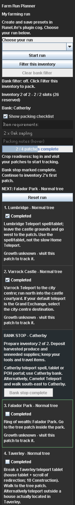

# Inventory planning and bank stops

Set these options in the normal RuneLite cog under **Inventory planning**, then click **Save preset**. The run tab uses the saved choices.

| Setting | Effect |
| --- | --- |
| Plan inventory loads | Split the prepared patch order into loads and add bank stops; enabled by default. Disable for a full remaining-run supply list. |
| Reserved inventory slots | Space kept for travel items, other gear and harvested produce; 8 by default, adjustable from 0 to 27. |
| Pack protection as notes | Plan noteable protection payments as single stacks and require notes in their checklist rows; enabled by default. |
| Bank between inventories | The player's bank choice for every resupply stop in this preset. |
| Custom bank instructions | Directions shown when Custom bank is selected; up to 500 characters. |

The compact list checks carried items only. It never reads bank ownership, withdraws supplies, changes withdrawal mode or opens a bank. Start run packs the first inventory and clears old progress after confirmation. **Filter this inventory** refreshes the bank display for the current load without resetting progress.

Finish the current load's patches to advance its packing list. The next route step is the chosen bank. Deposit produce and unneeded supplies, keep tools and travel items, and withdraw the next list yourself. **Banked - continue** acknowledges that stop. Patch progress and bank acknowledgments survive a restart; starting, resetting or loading a saved run clears both. Reopening an earlier patch clears bank acknowledgments after that inventory. Settings changes rebuild the plan and invalidate its old bank acknowledgments.

## How loads are calculated

RuneLite's public item definitions supply inventory stackability and whether a payment can be noted. Definitions are read on the client thread. The sidebar waits for them before enabling Start or claiming a load fits. It then calculates the plan in the background from an immutable settings snapshot.

Seeds and coins use one slot per item stack. Saplings and ordinary compost buckets use one slot each. A filled bottomless compost bucket uses one slot; its charges and type remain a manual check. Noteable protection payments use one slot per payment stack when the notes option is enabled. Loose payment and planting quantities sharing an item ID are added together; noted payments remain separate. The selected tools and coin allowance are included in each load that needs them.

The planner keeps the prepared patch order and chooses contiguous loads. It minimizes the number of loads first, then the estimated bank detour cost, then prefers a fuller first load on a tie. The bank cost uses relative travel scores, with local walking allowances at Catherby and the Farming Guild. It is not live pathfinding or a measured travel-time estimate. Route optimization still happens before load planning; this is not a joint search over every patch order and bank placement.

Load boundaries stay fixed as patches are completed. Within a load, completed patches disappear from its supply quantities. Changing patches, crops, supply options, travel or inventory settings recomputes the plan. If one patch's supplies exceed capacity, that patch remains as a separate load and the sidebar flags the shortage of space.

Capacity describes the planned starting supplies. It does not measure unrelated carried items, forecast harvest yield, inspect containers or discount a tool's slot when worn. Set the reserve to match your travel gear and expected harvest, and note or bank produce manually. Optional protection still takes space when included; turn off its supply recommendation if you do not intend to carry it. A green item row confirms possession, not that the whole run can be completed without further banking.

## Bank choices and travel

These are directions only. Players need the listed items and unlocks; the plugin does not verify travel access or include teleport supplies automatically.

| Bank | Suggested arrival |
| --- | --- |
| Grand Exchange | Ring of wealth; Varrock's Grand Exchange destination needs the medium Varrock diary. |
| Castle Wars | Ring of dueling to the lobby bank chest on a members world. |
| Ferox Enclave | Ring of dueling, then the bank inside the enclave. |
| Farming Guild | Skills necklace; enter at 45 Farming and use the central bank chest. |
| Catherby | Catherby spell, tablet or POH portal; alternatively Camelot and walk south-east. |
| Seers' Village | Camelot and walk west; direct bank destination requires the hard Kandarin diary. |
| Edgeville | Amulet of glory. |
| Draynor Village | Amulet of glory. |
| Falador west | Falador spell or tablet, then walk to the west bank. |
| Custom bank | The player's own directions; default text asks the player to travel and resupply manually. |

Checked against RuneLite 1.13.2 and OSRS Wiki on 2026-10-18. Public item methods are documented in [ItemComposition](https://static.runelite.net/runelite-api/apidocs/net/runelite/api/ItemComposition.html). Bank access and destinations are described in [Grand Exchange](https://oldschool.runescape.wiki/w/Grand_Exchange), [ring of dueling](https://oldschool.runescape.wiki/w/Ring_of_dueling), [Farming Guild](https://oldschool.runescape.wiki/w/Farming_Guild), [Catherby teleport](https://oldschool.runescape.wiki/w/Catherby_Teleport), [Camelot Teleport](https://oldschool.runescape.wiki/w/Camelot_Teleport), [amulet of glory](https://oldschool.runescape.wiki/w/Amulet_of_glory) and [Falador Teleport](https://oldschool.runescape.wiki/w/Falador_Teleport).

Backup format 3 includes these options. Formats 1 and 2 remain importable and use the defaults above. Bank acknowledgments and item metadata are excluded from preset backups. There is no new network connection or player-data service.
