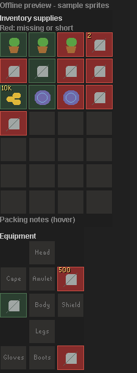

# Visual packing and saved equipment

Click the **eye button beside Packing checklist** to reveal your backpack, equipment and calculated requirements. The section starts collapsed when the plugin opens, and keeps your expanded/collapsed choice during progress updates. Click the eye again to hide it and return that space to the route. Hiding the display does not stop carried-item checks or change the bank setup.

Select **Grid** or **List** inside the expanded section. The same choice is available under **Checklist display → Packing view** in RuneLite's normal plugin cog. Grid is the default. The display choice applies across presets and does not reset completion or bank acknowledgments.

The inventory grid contains the supplies generated for the current load. Saplings and other nonstackable supplies occupy individual cells. Seeds, tablets, coins and noted protection payments show their required stack size. A missing or short cell is red, a packed cell is green, and an unknown cell is gray. Hover for the full item name, required quantity, carried quantity and shortage. Items can sit anywhere in your backpack: the grid is a preview, not an enforced arrangement.

The preview above uses geometric fixture sprites to verify layout without running a game client. In RuneLite, item icons come from its public `ItemManager` cache, including noted item sprites. The inventory grid is bounded to 28 cells; an oversized load shows an explicit overflow message. List retains every requirement. Reserved empty cells identify space for other gear and harvested crops. The planner waits for real item definitions before deciding which items stack.

## Capture backpack and worn gear

Select a saved farming preset on the main tab and open **Inventory setup**. Arrange your backpack and wear the gear you want, then click **Capture backpack and gear**. Review the preview, choose the bank display, and click the physical **Save setup** button. **Back to run** returns to the checklist. Unsaved changes can be explicitly discarded in the editor; there is no separate window or automatic save.

The captured backpack preserves item positions, quantities and note forms. Grid checks each saved slot, including positions intended to stay empty. Stack quantities must be at least the captured amount. Exact backpack item IDs are checked; a different jewellery charge variant in a backpack slot is a different item. Equipment retains the existing supported usable-charge alternatives and must be worn in the saved slot. Merely carrying gear leaves that equipment slot red. Check charges and daily limits yourself.

Captures use RuneLite's normalized item IDs, including graceful and boots of lightness. Placeholders never count as owned items. Empty backpack and empty equipment captures are valid when deliberately captured and saved. Logged-out captures preserve the draft. Late results cannot change an editor after it is closed, disposed or invalidated by a preset/profile change.

Your captured setup stays fixed throughout the run and supplies the bank filter and layout. The calculated farming requirements remain below it and continue to follow unfinished patches and current inventory loads. Compare those requirements before capturing; a saved capture can omit a needed item. Multi-inventory runs use the same captured setup at every stop. Generated load estimates still describe calculated farming supplies and reserved space, rather than the contents of your custom capture.

Choose **Use calculated run supplies**, then Save setup, to remove the custom backpack and gear. Presets without a captured backpack keep the generated grid, with one cell per sapling, stack quantities and overflow messages. The [setup editor guide](setup-editor.md) explains the controls.

## Storage and compatibility

Explicit captures are stored with the named farming preset as item IDs, positions, quantities, noted forms and equipment slots. Ongoing container observations remain transient. There is no backend, telemetry or external database. RuneLite's native configuration and optional native sync still behave normally.

Backup format 7 includes the captured backpack. Formats 1-6 import without one, preserving their supported gear and settings; formats 1-4 have no saved equipment. The global Grid/List choice is excluded from preset backups. See [bank display](setup-banking.md) for the core-owned generated layout cache.

## References and checks

The inventory/equipment panels and missing-item presentation were informed by the [Inventory Setups documentation](https://github.com/dillydill123/inventory-setups#highlighting). RuneLite provides [equipment slot IDs](https://static.runelite.net/runelite-api/apidocs/net/runelite/api/EquipmentInventorySlot.html), [item containers](https://static.runelite.net/runelite-api/apidocs/net/runelite/api/ItemContainer.html), and item sprites. This implementation uses the farming planner's existing supply and inventory-load models.

Offline checks cover unstacked items, noted sprites, partial stacks, overflow bounds, worn-slot checks, charge variants, quantity changes, capture races, preset persistence, old-backup migration, bank-filter inclusion, metadata retry and rendered layout at sidebar width. No game account is needed for those checks.
