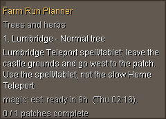

# Current farming step overlay

After you click **Start run**, the top-left overlay shows your current farming step without keeping the sidebar open:

- Run name, stop number and patch name.
- The same teleport or walking directions used in the sidebar.
- The crop's estimated readiness when tracking is enabled.
- Gardener and access notes when **Show access notes** is enabled.
- Patch completion count while the run is active.

It follows the prepared route, including skipped growing hardwoods. A pending bank stop replaces the patch directions with the chosen bank's arrival instructions and which inventory to prepare. Marking **Banked - continue** in the sidebar advances to the next patch. Manual completion and optional observed replant completion update the overlay. The final completed patch hides it automatically. The sidebar retains its completed checklist and green progress bar.

Selecting a preset, observing crop readiness, checking patches manually or opening the plugin does not start the overlay. Resetting or switching presets ends its active display; click Start run again to show it. Undoing a completion after the run has finished does not bring the overlay back. A preset containing only skipped growing hardwoods stays hidden because no run can be started. Run-display activation is held only in memory, so restarting the plugin also requires Start run again.

The Start run button changes to **Stop run** during an active run. Stop hides the overlay, step borders and teleport outline and closes the linked bank setup without changing patch or bank completion marks. It remains enabled during planning refreshes. The button returns to Start run after stopping or finishing. Starting again retains the existing fresh-run behavior and asks before clearing saved completion marks.

The global **Checklist display → Show current step on screen** setting defaults to on. Loading a preset does not change it. RuneLite's normal Alt-drag controls move the panel; its standard resize controls change the width. The panel hides when logged out, when no patches are selected, while editing a captured inventory setup, and when the plugin is disabled. Pending planning shows a preparation message instead of stale directions.

The overlay is read-only. Patch checkboxes and bank acknowledgments stay in the sidebar. No input, movement, banking or other game actions are performed. No Quest Helper dependency or code is used. The implementation uses RuneLite's public [OverlayPanel](https://github.com/runelite/runelite/blob/runelite-parent-1.13.3/runelite-client/src/main/java/net/runelite/client/ui/overlay/OverlayPanel.java) and [LineComponent](https://github.com/runelite/runelite/blob/runelite-parent-1.13.3/runelite-client/src/main/java/net/runelite/client/ui/overlay/components/LineComponent.java) APIs. Swing builds immutable step snapshots and publishes them through a volatile field; rendering never reads Swing components or mutable crop records.

This image is rendered offline with fixture crop observations. Tests cover progress transitions, bank acknowledgments, walking directions, countdown refreshes, pending planning, empty and skipped selections, editor/shutdown hiding, logged-out and disabled rendering, plain-text handling and long names. No authenticated game session was used. Actual placement alongside other installed overlays remains a live-client check.

The October 21 fix keeps the default width on the panel component and accepts RuneLite's null preferred size when no saved dimensions exist. A regression test renders first-load, resized and reset states. This addresses the rendering exception seen in the user's client log; no account or game actions were used to diagnose or test the fix.
