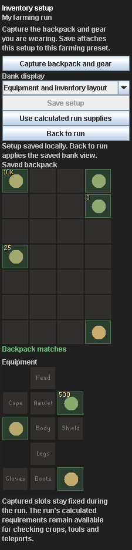

# Backpack and gear editor

The main plugin tab has an **Inventory setup** button. It opens a separate editor inside the same sidebar, with physical Capture and Save buttons. Crop tiers, patches, travel and farming-preset management remain in the normal RuneLite cog.

## Capture and save

1. Save your farming preset in the cog and select its name on the main tab.
2. Click **Inventory setup**.
3. Arrange your backpack and wear the gear you want to save.
4. Click **Capture backpack and gear**.
5. Review the preview and choose the bank-display option.
6. Click **Save setup**, then **Back to run**.

Capture reads the current inventory and worn-equipment containers on RuneLite's client thread. It does not read bank ownership. The backpack preserves all 28 positions, empty slots, stack quantities, and noted/unnoted forms. RuneLite normalizes worn-item forms such as graceful into their ordinary item IDs.

Capture changes the editor's draft only. Closing a changed editor offers **Discard changes and back**; it never silently saves. Save setup changes only that farming preset's captured backpack, equipment and bank-display choice. It keeps the selected patches, crops, travel settings, checklist progress, bank acknowledgments and other presets. It also preserves unrelated unsaved cog edits.

Logged-out captures keep the draft. Empty captures are valid when deliberately captured and saved. Late results cannot alter a closed or disposed editor. If the same setup was saved elsewhere while editing, saving reports the conflict and keeps your draft instead of overwriting the newer setup. A failed local write leaves the old preset and active setup intact.

## Checks and bank display

Red backpack slots have the wrong item, wrong noted form, insufficient quantity or an unexpected item in a slot saved as empty. Green slots match their saved item and at least the captured quantity. Gray means unknown. Backpack item IDs match exactly, including the captured charge variant. Equipment checks the intended worn slot and retains the supported usable teleport-jewellery alternatives. Neither check verifies stored charges or daily limits.

The saved capture supplies both the sidebar preview and bank display. The default bank layout places gear on the left and the captured backpack positions on the right. **Filter only** gives a compact matching bank view; **Off** keeps the sidebar without a farming bank display. Withdrawing, moving items, choosing notes, equipping and travel remain manual.

Calculated **Item requirements** remain underneath the saved setup and follow the unfinished patches and current load. They still include the configured crop tier, tools, protection, coins and teleport supplies. A capture records what you chose to carry; it does not automatically insert forgotten requirements.

The captured setup stays fixed during the run and is used at each bank stop. For runs with several inventories, the calculated requirements still advance per load. Generated capacity estimates cover calculated farming supplies and reserved slots, rather than proving a custom capture is sufficient for the route.

Choose **Use calculated run supplies** and then Save setup to remove the captured backpack and gear. The run returns to its generated supply grid. Existing presets without a captured backpack continue to use calculated supplies.

## Storage and preview

Only explicit captures are persisted with the local named preset. Ordinary live observations remain transient. Backup format 7 includes captures; formats 1-6 import without a captured backpack and preserve their supported settings. Native RuneLite configuration and optional sync behave normally. There is no new database, backend or telemetry.

The preview uses fixture sprites and a headless desktop theme. RuneLite supplies real item icons and its usual dark controls. No game client or account was used for this preview. Offline tests cover capture conversion, slot checks, notes, save/discard behavior, failed writes, stale captures, independent presets, bank positions, migration, retained progress and sidebar width.
